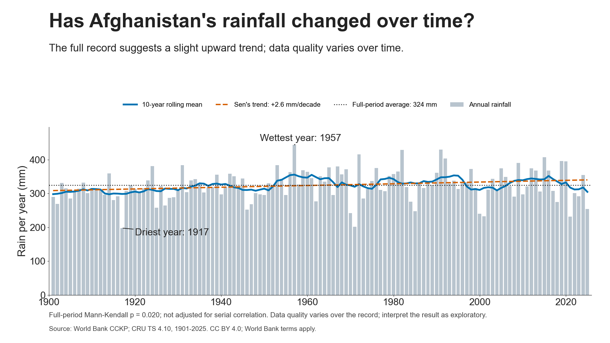
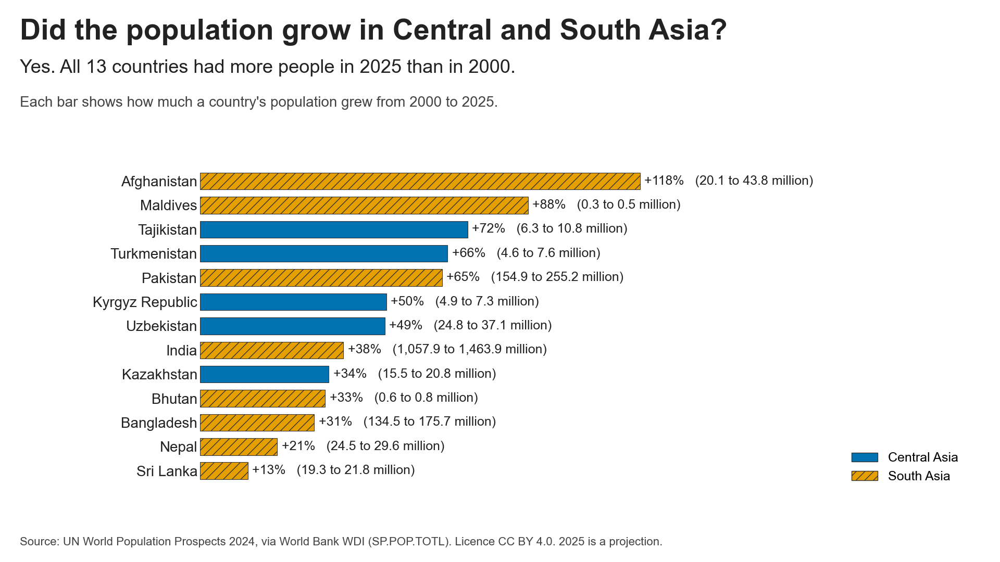
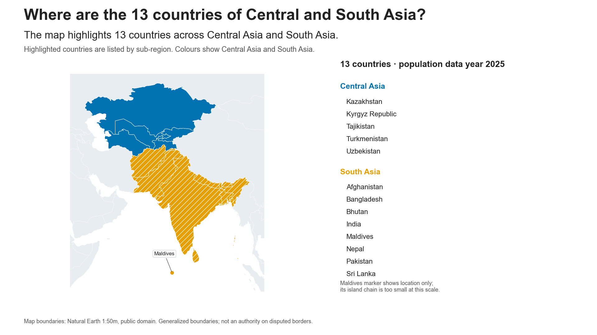
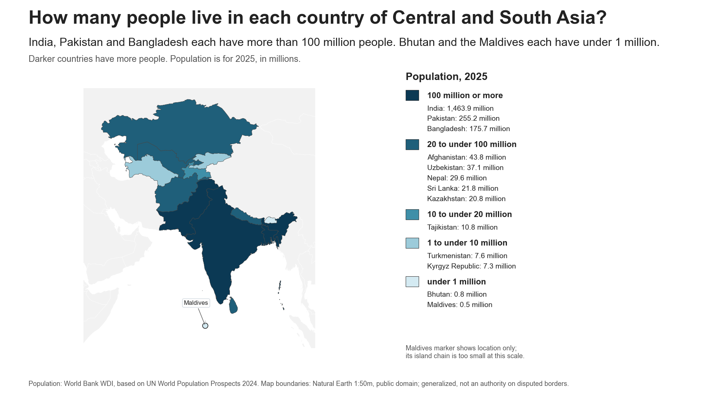
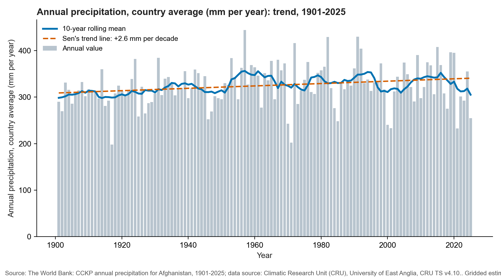
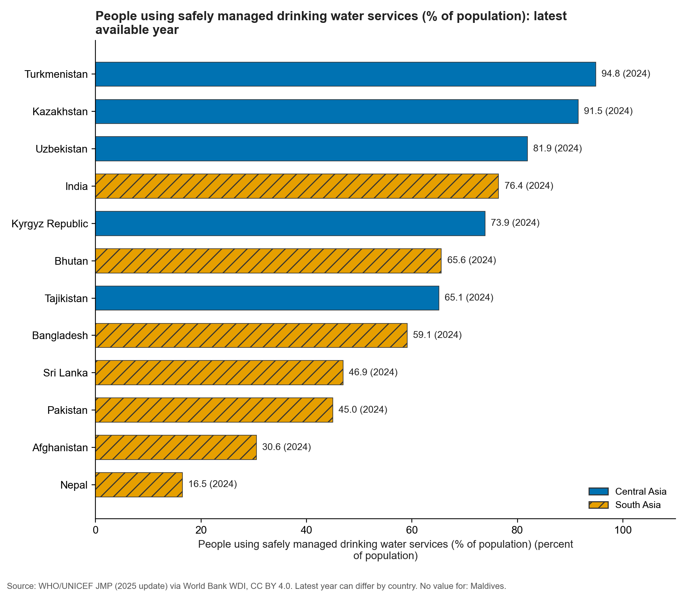

# Catalogue and showcase

*Generated by `python -m aab catalog` from each item's descriptor. Do not edit by hand.*

This page lists everything in the repository. Start with the infographics if you want the
story, the analyses if you want the evidence, and the datasets if you want the numbers.
Status: **draft** items are being checked; **published** items are final for this version.

## Infographics

### Has Afghanistan's rainfall changed over time?

**Question:** How has annual precipitation in Afghanistan changed from 1901 to 2025?  
**Answer:** The full record suggests a slight upward trend; data quality varies over time.  
**Audience:** Teachers; Students who can read a line chart and a bar chart  
**Status:** draft, version 0.1.0

Sources: [Teacher or companion notes](infographics/afghanistan-rainfall-trend/README.md) · [Analysis: afghanistan-rainfall-trend](analysis/afghanistan-rainfall-trend/README.md) · [Dataset: afghanistan-precipitation](data/datasets/afghanistan-precipitation/README.md)

### Did the population grow in Central and South Asia?

**Question:** Did the population grow in each country of Central and South Asia between 2000 and 2025?  
**Answer:** Yes. All 13 countries had more people in 2025 than in 2000.  
**Audience:** Teachers; Students (secondary school); General public  
**Status:** published, version 0.1.0

Sources: [Teacher or companion notes](infographics/population-growth-infographic/README.md) · [Analysis: population-growth-2000-2025](analysis/population-growth-2000-2025/README.md) · [Dataset: population-central-south-asia](data/datasets/population-central-south-asia/README.md)

### Where are the 13 countries of Central and South Asia?

**Question:** Where are the 13 countries of Central and South Asia?  
**Answer:** The map highlights 13 countries across Central Asia and South Asia.  
**Audience:** Teachers; Students (secondary school); General public  
**Status:** published, version 0.1.0

Sources: [Teacher or companion notes](infographics/population-map-infographic/README.md) · [Dataset: population-central-south-asia](data/datasets/population-central-south-asia/README.md)

### How many people live in each country of Central and South Asia?

**Question:** How many people live in each of the 13 countries of Central and South Asia?  
**Answer:** India, Pakistan and Bangladesh each have more than 100 million people. Bhutan and the Maldives each have under 1 million.  
**Audience:** Teachers; Students (secondary school); General public  
**Status:** published, version 0.1.0

Sources: [Teacher or companion notes](infographics/population-size-map-infographic/README.md) · [Analysis: population-ranking-2025](analysis/population-ranking-2025/README.md) · [Dataset: population-central-south-asia](data/datasets/population-central-south-asia/README.md)

## Analyses

### Annual precipitation in Afghanistan, 1901-2025, trend

**Question:** How has annual precipitation in Afghanistan changed from 1901 to 2025?  
**Method:** `trend`  
**Status:** draft, version 0.1.0

Read more: [findings](analysis/afghanistan-rainfall-trend/README.md) · [results](analysis/afghanistan-rainfall-trend/outputs/results.md) · [data behind the chart](analysis/afghanistan-rainfall-trend/outputs/table.csv)

### Population change in Central and South Asian countries, 2000-2025

**Question:** Did the population of each of the 13 countries in Central and South Asia grow between 2000 and 2025?  
**Method:** `custom`  
**Status:** published, version 0.1.0

Read more: [findings](analysis/population-growth-2000-2025/README.md) · [results](analysis/population-growth-2000-2025/outputs/results.md) · [data behind the chart](analysis/population-growth-2000-2025/outputs/table.csv)

### Total population of Central and South Asian countries, 2025

**Question:** How do the 13 countries in Central and South Asia compare on total population in 2025?  
**Method:** `custom`  
**Status:** published, version 0.1.0

Read more: [findings](analysis/population-ranking-2025/README.md) · [results](analysis/population-ranking-2025/outputs/results.md) · [data behind the chart](analysis/population-ranking-2025/outputs/table.csv)

### Drinking water access ranking, latest year

**Question:** How do countries in Central and South Asia compare on the share of their population using safely managed drinking water?  
**Method:** `ranking`  
**Status:** published, version 0.1.0

Read more: [findings](analysis/water-access-ranking/README.md) · [results](analysis/water-access-ranking/outputs/results.md) · [data behind the chart](analysis/water-access-ranking/outputs/table.csv)

## Datasets

| Dataset | Themes | Countries | Years | Indicators | Sources | Status | Version |
|---|---|---|---|---|---|---|---|
| [Annual precipitation in Afghanistan, 1901-2025](data/datasets/afghanistan-precipitation/README.md) | climate | 1 (afghanistan) | 1901-2025 | 1 | cru-ts-precipitation | draft | 0.1.0 |
| [Drinking water access in Central and South Asia, 2000-2024](data/datasets/drinking-water-access/README.md) | water-access | 13 (central_and_south_asia) | 2000-2024 | 2 | jmp-household-water | published | 0.1.0 |
| [Total population in Central and South Asia, 2000-2025](data/datasets/population-central-south-asia/README.md) | population | 13 (central_and_south_asia) | 2000-2025 | 1 | wdi-population | published | 0.1.0 |

## Sources

| Source | Producer | How the data is obtained | Licence | Known issues |
|---|---|---|---|---|
| [CCKP country-average annual precipitation, CRU TS 4.10 (Afghanistan)](data/sources/cru-ts-precipitation/README.md) | Climatic Research Unit (CRU), University of East Anglia | Downloaded by hand, then checked | CC-BY-4.0 under World Bank Dataset Terms (documented working determination) | None recorded |
| [WHO/UNICEF Joint Monitoring Programme (JMP): household estimates of water, sanitation and hygiene, 2025 update](data/sources/jmp-household-water/README.md) | WHO and UNICEF, Joint Monitoring Programme for Water Supply, Sanitation and Hygiene | Downloaded by the pipeline | CC-BY-4.0 | None recorded |
| [Natural Earth Admin 0 country boundaries, 1:50m and 1:110m GeoJSON](data/sources/natural-earth-countries/README.md) | Natural Earth | Downloaded by hand, then checked | Public domain | The 1:110m file does not include Maldives. The 1:50m file includes it, but the island chain may still be too small to see clearly at regional-map scale.; Boundaries are generalized cartographic references. Natural Earth depicts de facto boundaries and is not an authority on disputed borders. |
| [World Bank World Development Indicators: Population, total (SP.POP.TOTL), based on UN World Population Prospects](data/sources/wdi-population/README.md) | United Nations Population Division (World Population Prospects), and national statistical offices | Downloaded by the pipeline | CC-BY-4.0 | None recorded |
