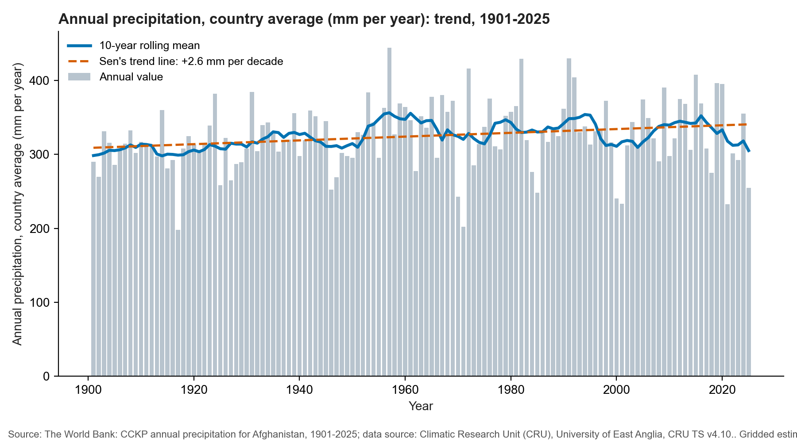

# Annual precipitation in Afghanistan, 1901-2025, trend: results

*Generated by `python -m aab build`. Do not edit by hand. The numbers depend only on the input datasets, so the file is the same on every rebuild.*

**Question:** How has annual precipitation in Afghanistan changed from 1901 to 2025?
**Method:** `trend`. Sen's slope is a robust estimate of the trend. The conventional Mann-Kendall test asks whether the trend is larger than year-to-year variation would explain, but its p-value does not adjust for serial correlation or changing data quality.

**Input datasets**

- `afghanistan-precipitation` version 0.1.0, file checksum (SHA-256) `6b687602e2110829ee4bd9cc5fd34254037a9058bef1ffdd0e3988cb3e0e82ce`

## Key results

- Direction: increasing. Sen's slope says the value changes by +2.55 mm per decade, with a 95% interval of +0.48 to +4.63.
- Change implied by the slope over the period: +31.6 mm between the first and last year, about +0.8% of the mean per decade.
- Mean over the period: 324.4 mm per year.
- Wettest year: 1957 (443.9). Driest year: 1917 (198.0).
- Mann-Kendall test: S = 1090, z = 2.32, p = 0.020. The trend is statistically significant at the 5% level.

**Decadal means**

| Decade | Mean (mm per year) | Years |
|---|---|---|
| 1900s (partial decade) | 305.0 | 9 |
| 1910s | 300.1 | 10 |
| 1920s | 307.5 | 10 |
| 1930s | 330.3 | 10 |
| 1940s | 310.7 | 10 |
| 1950s | 347.6 | 10 |
| 1960s | 345.7 | 10 |
| 1970s | 314.1 | 10 |
| 1980s | 330.1 | 10 |
| 1990s | 352.9 | 10 |
| 2000s | 316.8 | 10 |
| 2010s | 342.3 | 10 |
| 2020s (partial decade) | 305.0 | 6 |

Source: The World Bank: CCKP annual precipitation for Afghanistan, 1901-2025; data source: Climatic Research Unit (CRU), University of East Anglia, CRU TS v4.10.. Gridded estimates; station coverage and data quality vary across the record.
