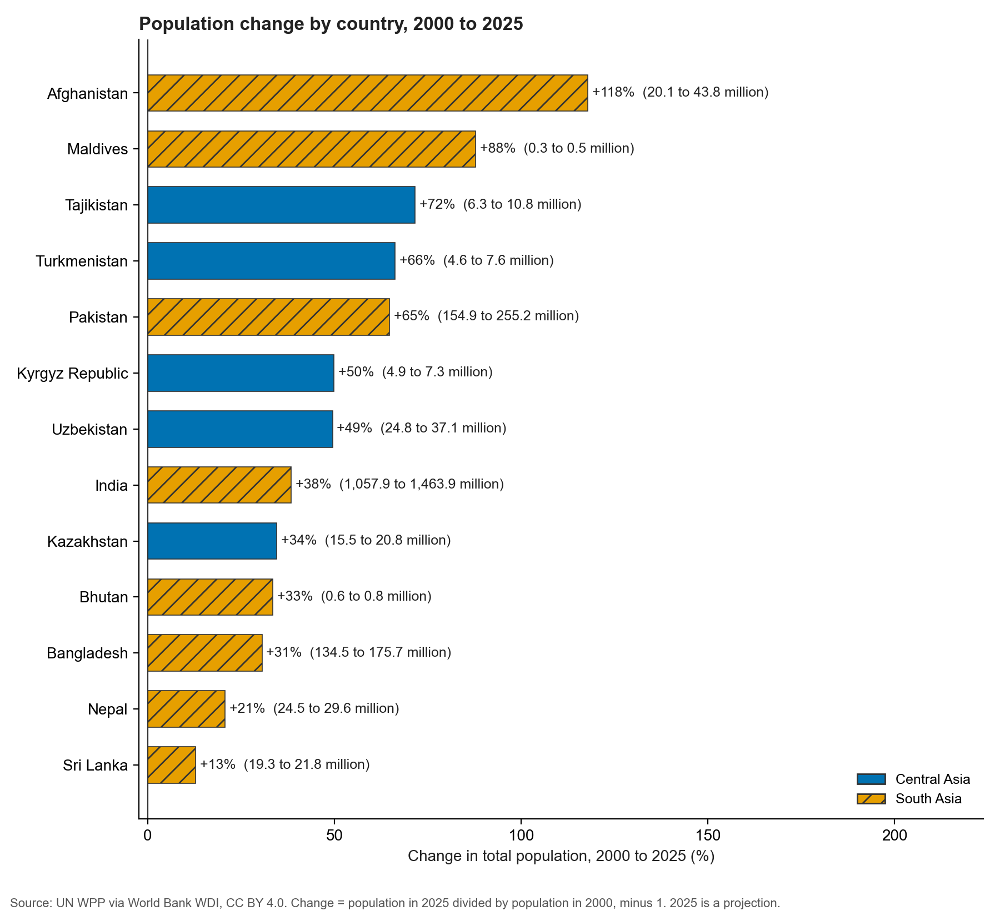

# Population change in Central and South Asian countries, 2000-2025

**Question:** Did the population of each of the 13 countries in Central and South Asia grow between 2000 and 2025?

**Reads:** [`population-central-south-asia`](../../data/datasets/population-central-south-asia/README.md), version 0.1.0.

**Method:** A custom script (`analysis.py`). For each country it compares the population in 2025 with the population in 2000. Change = population in 2025 divided by population in 2000, minus 1. It also gives the average yearly change, which is the compound annual rate. The analysis does not estimate any value.

## Findings

- All 13 countries grew. Thirteen of 13 had a larger population in 2025 than in 2000.
- Afghanistan had the largest rise: +117.8%, from 20.1 million in 2000 to 43.8 million in 2025.
- Sri Lanka had the smallest change: +12.8%, from 19.3 million in 2000 to 21.8 million in 2025.
- Across the 13 countries, the median average yearly change was 1.62% per year between 2000 and 2025.

## Figure

## Read carefully

- The 2000 values are model-based estimates. The 2025 values are projections, because the UN World Population Prospects 2024 estimates end in 2023. The growth to 2025 therefore depends partly on the model's assumptions.
- Afghanistan's figures are the least certain in the group. The UN-based figure for 2025 is 43.8 million, while the National Statistics and Information Authority (NSIA) reported 36.4 million for 2025. The 2000 figure comes from the same UN-based series. The percentage rise should be read as approximate.
- The chart compares percentage change, not size. A country with a small population can show a large percentage rise from a modest change in numbers.
- The average yearly change is a summary. It hides the variation from year to year, which this analysis does not show.

## Outputs

- [Results](outputs/results.md)
- [Data behind the chart](outputs/table.csv)
- [Summary](outputs/summary.json)
