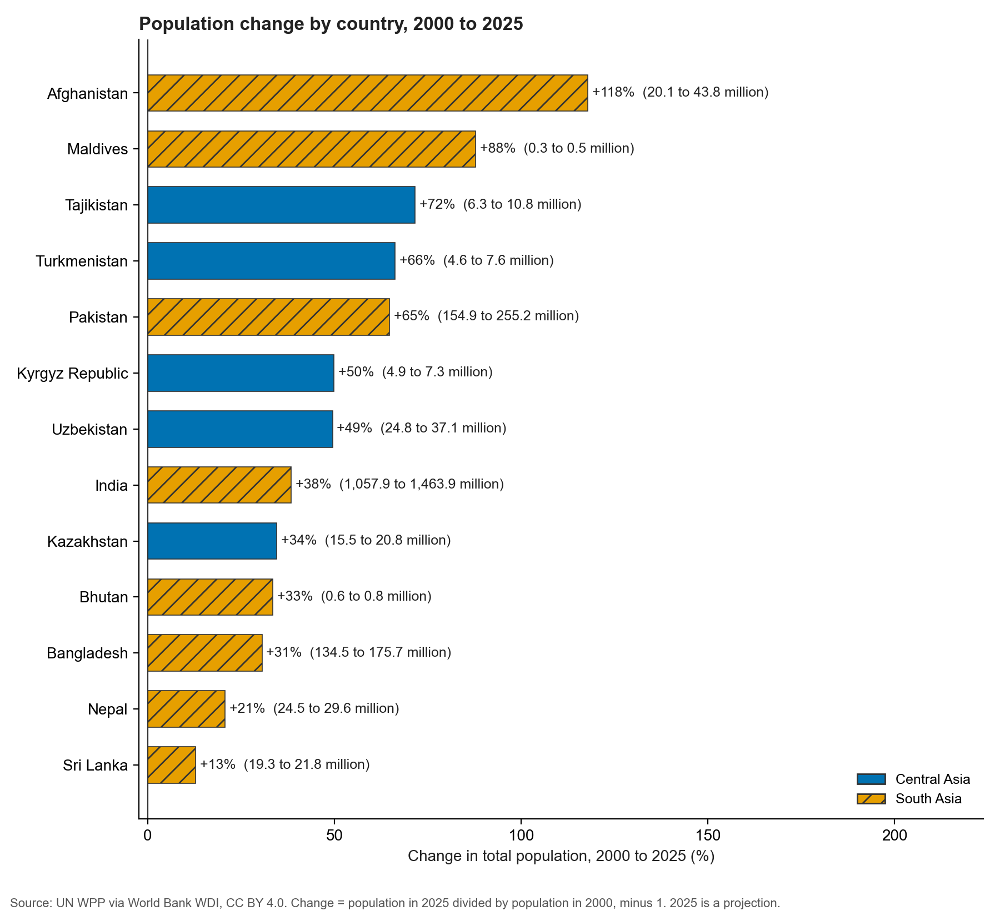

# Population change in Central and South Asian countries, 2000-2025: results

*Generated by `python -m aab build`. Do not edit by hand. The numbers depend only on the input datasets, so the file is the same on every rebuild.*

**Question:** Did the population of each of the 13 countries in Central and South Asia grow between 2000 and 2025?
**Method:** `custom`. Each country's population in the first and last year is compared. Countries are ordered from largest to smallest change.

**Input datasets**

- `population-central-south-asia` version 0.1.0, file checksum (SHA-256) `11843b30a099c317c86d2d36c0e46151f78d05fa794de3ffc855e1460848e88b`

## Key results

- Countries whose population grew from 2000 to 2025: 13 of 13.
- Largest rise: Afghanistan, +117.8% (20.1 million to 43.8 million).
- Smallest change: Sri Lanka, +12.8% (19.3 million to 21.8 million).
- Median average yearly change across the 13 countries: 1.62% per year.

| Country | Sub-region | Change (%) | Average yearly change (%) |
|---|---|---|---|
| Afghanistan | South Asia | +117.8 | +3.16 |
| Maldives | South Asia | +87.8 | +2.55 |
| Tajikistan | Central Asia | +71.6 | +2.18 |
| Turkmenistan | Central Asia | +66.2 | +2.05 |
| Pakistan | South Asia | +64.8 | +2.02 |
| Kyrgyz Republic | Central Asia | +49.9 | +1.63 |
| Uzbekistan | Central Asia | +49.5 | +1.62 |
| India | South Asia | +38.4 | +1.31 |
| Kazakhstan | Central Asia | +34.5 | +1.19 |
| Bhutan | South Asia | +33.5 | +1.16 |
| Bangladesh | South Asia | +30.6 | +1.07 |
| Nepal | South Asia | +20.7 | +0.75 |
| Sri Lanka | South Asia | +12.8 | +0.48 |

Source: UN WPP via World Bank WDI, CC BY 4.0. Change = population in 2025 divided by population in 2000, minus 1. 2025 is a projection.
