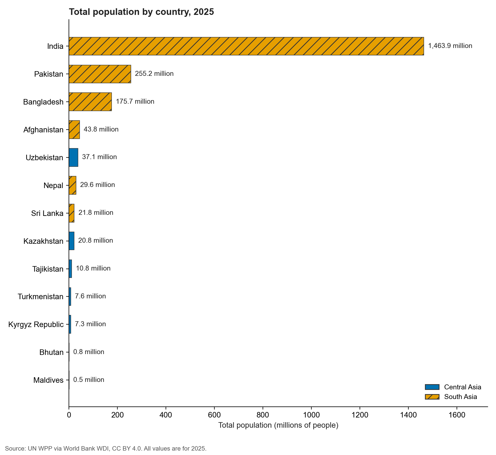

# Total population of Central and South Asian countries, 2025

**Question:** How do the 13 countries in Central and South Asia compare on total population in 2025?

**Reads:** [`population-central-south-asia`](../../data/datasets/population-central-south-asia/README.md), version 0.1.0.

**Method:** A custom script (`analysis.py`). It sorts the countries by total population in 2025 and shows them as a horizontal bar chart in millions. The analysis does not estimate or adjust any value.

## Findings

- India has the largest population: 1,463.9 million people in 2025. This is about 71% of the 2,075.0 million total for the 13 countries.
- Maldives has the smallest population: 0.5 million people in 2025.
- Together the 13 countries have 2,075.0 million people in 2025.

## Figure

## Read carefully

- All values are for 2025. The UN World Population Prospects 2024, distributed by the World Bank, is a model-based estimate, and 2025 is a projection, not a count.
- National figures can differ. For example, this dataset gives 43.8 million for Afghanistan, while the National Statistics and Information Authority (NSIA) reported 36.4 million for 2025.
- The chart compares countries. It does not show differences within each country.
- The Maldives bar is very short next to India's. The labels give exact values.

## Outputs

- [Results](outputs/results.md)
- [Data behind the chart](outputs/table.csv)
- [Summary](outputs/summary.json)
