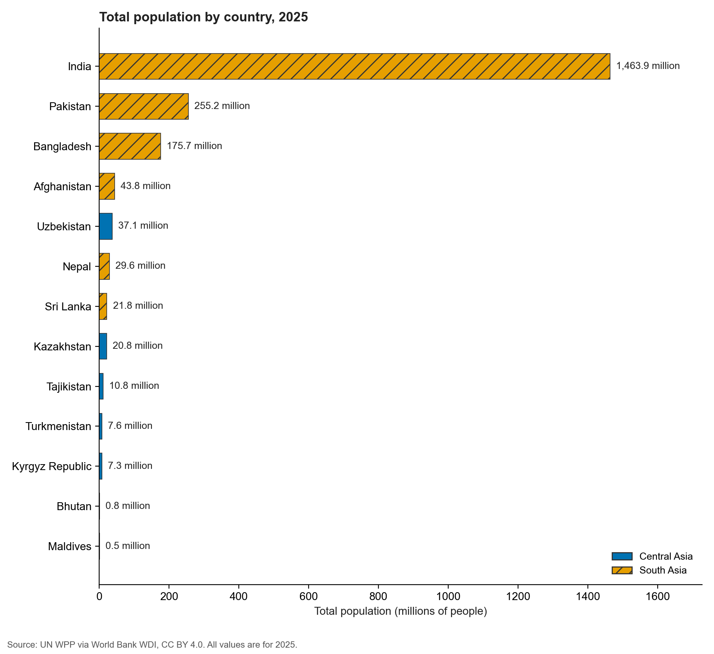

# Total population of Central and South Asian countries, 2025: results

*Generated by `python -m aab build`. Do not edit by hand. The numbers depend only on the input datasets, so the file is the same on every rebuild.*

**Question:** How do the 13 countries in Central and South Asia compare on total population in 2025?
**Method:** `custom`. Countries are ordered by total population in the reference year, largest first.

**Input datasets**

- `population-central-south-asia` version 0.1.0, file checksum (SHA-256) `11843b30a099c317c86d2d36c0e46151f78d05fa794de3ffc855e1460848e88b`

## Key results

- Largest: India, 1,463.9 million people (2025). This is 71% of the total for the 13 countries.
- Smallest: Maldives, 0.5 million people (2025).
- Total for the 13 countries: 2,075.0 million people (2025).

| Country | Sub-region | Population (people) |
|---|---|---|
| India | South Asia | 1,463,865,525 |
| Pakistan | South Asia | 255,219,554 |
| Bangladesh | South Asia | 175,686,899 |
| Afghanistan | South Asia | 43,844,111 |
| Uzbekistan | Central Asia | 37,053,428 |
| Nepal | South Asia | 29,618,118 |
| Sri Lanka | South Asia | 21,756,000 |
| Kazakhstan | Central Asia | 20,843,754 |
| Tajikistan | Central Asia | 10,786,734 |
| Turkmenistan | Central Asia | 7,618,847 |
| Kyrgyz Republic | Central Asia | 7,343,064 |
| Bhutan | South Asia | 796,682 |
| Maldives | South Asia | 529,676 |

Source: UN WPP via World Bank WDI, CC BY 4.0. All values are for 2025.
