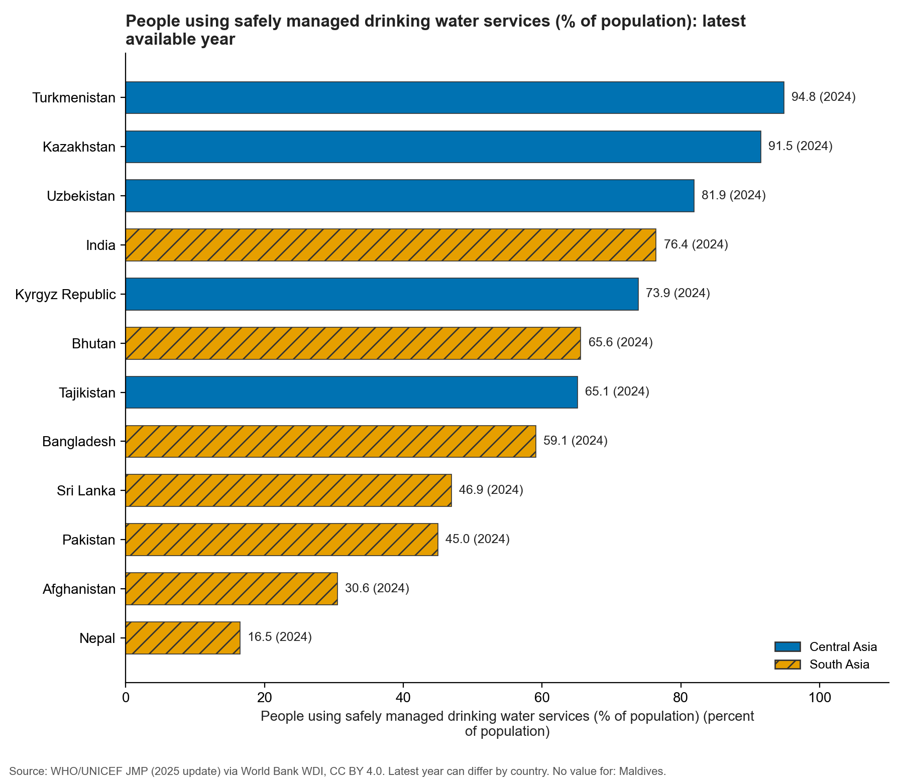

# Drinking water access ranking, latest year

**Question:** How do countries in Central and South Asia compare on the share of their population using safely managed drinking water?

**Reads:** dataset [`drinking-water-access`](../../data/datasets/drinking-water-access/README.md)
**Method:** ranking. Each country is shown at its latest available year.

## Findings

- Turkmenistan has the highest share (94.8% in 2024). Nepal has the lowest (16.5% in 2024). The gap is 78 percentage points.
- Four of the twelve countries with a value are below 50%: Nepal, Afghanistan, Pakistan and Sri Lanka.
- Simple averages of countries (not population-weighted) are 81.5% for Central Asia and 48.6% for South Asia. The South Asia average is pulled down by its larger share of countries with low access.
- Maldives has no value for safely managed water in this release, so it is not shown.

## Figure

## Read carefully

- These are modelled estimates. Check the year of each value. Latest years can differ.
- A ranking shows position, not the reasons for it. It does not say how fast access changed.
- The question also asks how access changed since 2000. This analysis does not answer that yet. A trend analysis of the same dataset is a good next step (see [question bank](../../docs/questions.md)).

## Outputs

- [Results with alt text and input checksums](outputs/results.md)
- [Data behind the chart](outputs/table.csv)
- [Machine-readable summary](outputs/summary.json)
