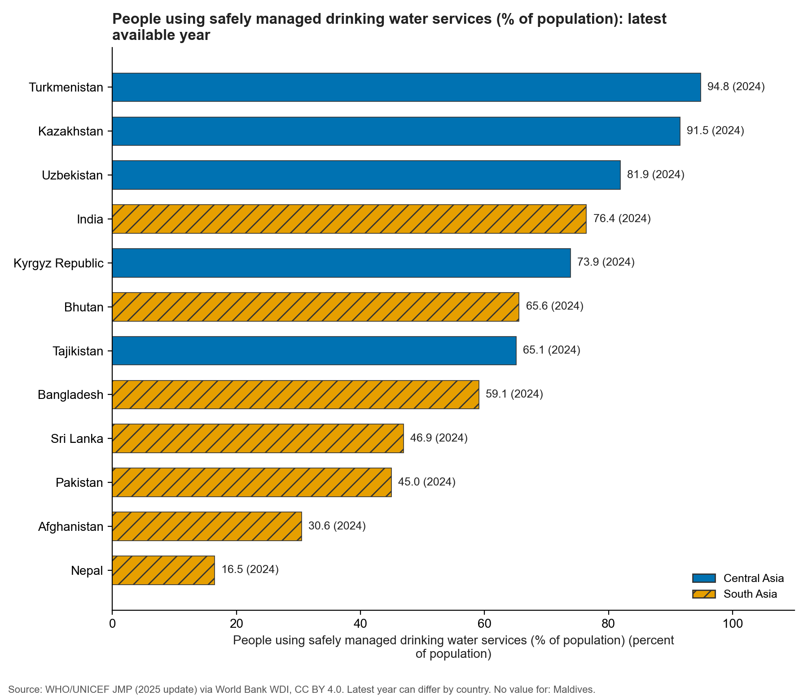

# Drinking water access ranking, latest year: results

*Generated by `python -m aab build`. Do not edit by hand. The numbers depend only on the input datasets, so the file is the same on every rebuild.*

**Question:** How do countries in Central and South Asia compare on the share of their population using safely managed drinking water?
**Method:** `ranking`. Countries are ranked on their latest available value. Each value shows its year.

**Input datasets**

- `drinking-water-access` version 0.1.0, file checksum (SHA-256) `3861ba5fd4f2e0b83b081d855432245de298ab75d03339ecd8a9ec5431f9e981`

## Key results

- Highest: Turkmenistan at 94.8 (2024).
- Lowest: Nepal at 16.5 (2024).
- Gap between highest and lowest: 78.4 points.
- Unweighted sub-region averages: Central Asia 81.5, South Asia 48.6. These are simple averages of countries, not population-weighted.
- No value for this indicator: Maldives. These countries are in the group but absent from the source for this indicator.

| Country | Sub-region | Latest year | Value (percent of population) |
|---|---|---|---|
| Turkmenistan | Central Asia | 2024 | 94.8 |
| Kazakhstan | Central Asia | 2024 | 91.5 |
| Uzbekistan | Central Asia | 2024 | 81.9 |
| India | South Asia | 2024 | 76.4 |
| Kyrgyz Republic | Central Asia | 2024 | 73.9 |
| Bhutan | South Asia | 2024 | 65.6 |
| Tajikistan | Central Asia | 2024 | 65.1 |
| Bangladesh | South Asia | 2024 | 59.1 |
| Sri Lanka | South Asia | 2024 | 46.9 |
| Pakistan | South Asia | 2024 | 45.0 |
| Afghanistan | South Asia | 2024 | 30.6 |
| Nepal | South Asia | 2024 | 16.5 |

Source: WHO/UNICEF JMP (2025 update) via World Bank WDI, CC BY 4.0. Latest year can differ by country. No value for: Maldives.
