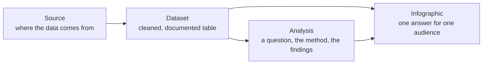

# Guide

How the repository is organised, what its terms mean, and how to contribute.

Start with the [README](../README.md). The [question bank and ideas](questions.md) lists possible additions. [Accessibility guidance](accessibility.md) covers figures and infographics. [Project decisions](decisions.md) explains the current structure and conventions.

## Contents

1. [Concepts](#1-concepts)
2. [Data and code standards](#2-data-and-code-standards)
3. [Adding to the repository](#3-adding-to-the-repository)
4. [Infographics](#4-infographics)
5. [Appendix: Glossary](#appendix-glossary)

## 1. Concepts

### The four kinds of item


| Term | What it is | Folder | Example |
|---|---|---|---|
| **Source** | Data from an original provider, kept unchanged, with a retrieval log | `data/sources/` | WHO/UNICEF JMP household water estimates |
| **Dataset** | A cleaned, documented table in the standard format, built from one or more sources | `data/datasets/` | Drinking water access, 2000–2024 |
| **Analysis** | One question, the datasets it reads, the method, and the findings | `analysis/` | Drinking water access ranking, latest year |
| **Infographic** | A communication product that gives one answer to one audience | `infographics/` | Has Afghanistan’s rainfall changed over time? |

Each item is one folder. It contains a descriptor (`source.yaml`, `dataset.yaml`, `analysis.yaml` or `infographic.yaml`) and a `README.md`.

The repository keeps sources, datasets, analyses, and infographics separate because each has a different role. See [Project decisions](decisions.md#organize-content-by-purpose).

### Rules that follow from the model

- **Raw data belongs to a source,** not to a dataset. Datasets that use the same source can share its raw files.
- **Raw files are preserved unchanged.** Their checksums are recorded in a retrieval log; changes are reported by validation.
- **Analyses and infographics use declared datasets,** not raw source files. Declared inputs tell the pipeline what an item depends on.
- **Map-only geometry exception:** an infographic may read a checksum-logged GeoJSON source directly to draw boundaries when a dataset format cannot represent polygons. Document the source in the infographic README, use the geometry only for drawing, and get names, categories, and quantitative claims from declared datasets.
- **Generated files are not edited by hand.** Tables, datapackages, analysis results, figures, and the catalogue are produced by the project tools.
- **Infographic claims are checked** against linked analysis results where the check is defined. The claim and the analysis must agree.

### Themes and audiences

- **Themes** group items across the catalogue, such as `water-access` and `climate`. Their names are listed in `project.yaml`.
- **Audiences** are listed in each infographic descriptor, such as teachers, data users, or researchers. They are not folders.

### Where things are generated

| Output | Written by | Edit by hand? |
|---|---|---|
| `<id>.csv` | Pipeline (dataset build) | No |
| `datapackage.json` | Pipeline | No |
| `analysis/<id>/outputs/*` | Pipeline (analysis run) | No |
| `infographics/<id>/outputs/infographic_<lang>.png` and `.svg` | Pipeline (`make.py`) | No |
| `CATALOG.md` | Pipeline | No |
| Item READMEs and descriptors | Contributors | Yes |

## 2. Data and code standards

The repository uses FAIR principles and common open-data practices as guidance. Each rule has one of these statuses:

- **Enforced:** checked automatically by the pipeline, validator, or continuous integration (CI).
- **Review:** contributors and reviewers should check it.
- **Planned:** intended for future work but not yet implemented.

Accessibility rules for figures and infographics are in [accessibility](accessibility.md).

### 2.1 Data

| Area | Rule | Status |
|---|---|---|
| Format | UTF-8 CSV, long (tidy) format: one row per country, year, and indicator; Unix line endings | Enforced |
| Packaging | Each dataset has a `datapackage.json`, generated from `dataset.yaml`, checked for currency by the validator and conformance by CI | Enforced |
| Data dictionary | Every column has a name, type, title, description, unit, and constraints in the schema | Enforced |
| Country codes | ISO 3166-1 alpha-3 codes; project registry in `aab/countries.csv` | Enforced |
| Coverage | Missing values by indicator and country are reported as warnings and explained in the dataset README | Enforced (warning) |
| Provinces and districts | ISO 3166-2 codes, such as `AF-BAL` | Planned for subnational datasets |
| Dates | ISO 8601, such as `2026` or `2026-10-28` | Review |
| Units | Stated per indicator in the `unit` column; SI units where applicable | Enforced (column required) |
| SDG indicators | Official SDG indicator number recorded in `dataset.yaml` and the datapackage | Review |
| Missing values | Not stored as rows or encoded as `0` or `-999` | Review |

**Regional groups.** UN M49 places Iran in Southern Asia, whereas the World Bank groups it with the Middle East and North Africa. Each dataset documents the country group it uses.

### 2.2 Sources and provenance

| Area | Rule | Status |
|---|---|---|
| Raw data | Kept unchanged in `data/sources/<id>/` | Enforced (checksum must match the log) |
| Retrieval log | `RETRIEVAL_LOG.csv` records time, file, URL, SHA-256 checksum, size, and note. Entries are append-only. | Enforced |
| Known issues | Recorded in `source.yaml`; shown as warnings and listed in the catalogue | Enforced |
| Licence | Check and record source terms before reuse. Third-party terms may differ from the repository’s licence. | Review |
| Citation | `CITATION.cff` and `codemeta.json` cite the repository; each source documents its own citation | Enforced (repository metadata consistency) |
| Data citation | Cite the dataset and original source; include the dataset version and retrieval date where relevant | Review |

### 2.3 Water definitions

Use published definitions rather than creating new ones:

- **SEEA-Water** (UN System of Environmental-Economic Accounting) for water accounts.
- **FAO AQUASTAT** variable definitions for national water resources and use.
- **WHO/UNICEF JMP** definitions for drinking water, sanitation, and hygiene.

Each source README should name the definitions it uses.

### 2.4 Analyses and statistics

| Area | Rule | Status |
|---|---|---|
| Method | Use a named method, state it in `analysis.yaml`, and describe it in the analysis README | Review |
| Uncertainty | Report intervals or p-values with trend and difference claims | Enforced for the trend method |
| Units in text | State changes as a value changing by a given amount per period | Review |
| Partial periods | Label decades or years with fewer than ten observations as partial | Enforced for the trend method |
| Generated results | Results record their input datasets and checksums; CI checks generated text files | Enforced in CI |
| Figures | Image files are not compared byte-for-byte by CI. Review rebuilt figures visually, especially after dependency or font changes. | Review |
| Input checksums | Results files record the SHA-256 checksum of each input dataset | Enforced |

### 2.5 Code

- Use Python 3.10 or later, PEP 8, and docstrings for modules and public functions.
- Shared code lives in the `aab` package. Dataset, analysis, and infographic folders contain configuration, documentation, and small scripts that use the package.
- Run tests with `python -m pytest -q`. If GNU Make is installed, `make test` is an optional shortcut. CI runs the tests.
- Rebuild with `python -m aab build`. If GNU Make is installed, `make all` is an optional shortcut.
- Generated files must be regenerated with the project tools, not edited by hand.

### 2.6 Where each rule is checked

| Check | Where |
|---|---|
| Schema, types, patterns, units, primary key, coverage | `aab/validate.py` |
| Raw files match their logs | `aab/validate.py` |
| Generated datapackages and catalogue are current | `aab/validate.py` |
| Alt text is present and long enough; figures exist | `aab/validate.py` |
| Datapackage conforms to the Frictionless specification | CI (`.github/workflows/validate.yml`) |
| Generated text files match committed outputs after a build | CI |
| Source, licence, known issues, and retrieval date | Pull-request review |

## 3. Adding to the repository

### 3.1 Add a source

A source is data from a provider, kept unchanged. Add one when you need data that no existing source provides.

1. **Check the licence and terms.** Record them. If the terms do not allow the intended reuse, do not add the data.
2. **Create the folder:** `python -m aab new source SLUG`, using a lowercase, hyphen-separated name for the provider and product.
3. **Fill in `data/sources/SLUG/source.yaml`.**
   - For a World Bank indicator, set `access.type: worldbank` and list the country group, years, and indicator codes.
   - For other sources, set `access.type: manual`, place the downloaded file in the source folder, and document the exact steps for obtaining it.
4. **Write `data/sources/SLUG/README.md`.** Explain how to obtain the data, its licence and required credit, and any known gaps.
5. **Record and check the source file.**
   - For World Bank sources, run `python -m aab build --refresh` to download the data.
   - For manual sources, run `python -m aab build`. On first use, the build records the checksum; on later runs, it checks the file against the log.
6. **Validate the repository:** run `python -m aab validate` and check that `RETRIEVAL_LOG.csv` has one row for each raw file.

Raw files are never edited. If the provider publishes a new release, download it and add a new log row. If a download is known to be wrong, record the issue under `known_issues` until it is resolved.

### 3.2 Add a dataset

A dataset is a cleaned table in the standard format, built from one or more sources.

1. **Check that each source exists** in `data/sources/`. Add a source first if needed.
2. **Create the folder:** `python -m aab new dataset SLUG`.
3. **Edit `data/datasets/SLUG/dataset.yaml`.** Set the sources, country group, years, and indicators. For each indicator, set `source` to the source it comes from.
4. **Build the dataset.** World Bank sources are handled by the pipeline. For other sources, add `transform.py` with a `build(dataset, sources)` function that returns a table with the standard columns (see `aab/tidy.py`). Use `aab` helpers; do not edit raw files.
5. **Write `data/datasets/SLUG/README.md`.** Include the sections Source, Method, Caveats, and How to cite. The validator checks for them.
6. **Build it:** `python -m aab build --dataset SLUG`.
7. **Read the warnings.** If a country has no values for an indicator, explain this in the README.
8. **Check the outputs:** `<id>.csv` and `datapackage.json`.

The `version` in `dataset.yaml` tracks that dataset, not the repository’s software version. Update it when the table changes: a patch for a fix, a minor version for new rows or columns, and a major version for a breaking change.

### 3.3 Add an analysis

An analysis answers one question using one or more datasets. It reports the method, findings, and limitations.

1. **Start from a question.** Check the [question bank](questions.md).
2. **Create the folder:** `python -m aab new analysis SLUG`.
3. **Edit `analysis/SLUG/analysis.yaml`.**
   - `inputs.datasets` must list every dataset read, including those read by custom code.
   - `method: ranking` ranks countries on their latest values.
   - `method: trend` calculates Sen’s slope, a 95% interval, and a Mann-Kendall test.
   - `method: custom` runs `analysis.py`.
4. **For `method: custom`,** write `analysis.py` with `run(ctx)`. Use `ctx.read("dataset-id")` to read a declared dataset. Return a `Result` (see `aab/analyses.py`). Several datasets can be used.
5. **Build it:** `python -m aab build --analysis SLUG`.
6. **Write `analysis/SLUG/README.md`.** State findings with the year and unit beside each number. Include a figure with alt text that states the finding, and explain the limitations. For figure rules, see [accessibility](accessibility.md).
7. **Check the outputs** in `outputs/`: figure, `table.csv`, `summary.json`, and `results.md`.

Findings must match `results.md`. If data changes, rebuild and update the findings. Do not edit generated files by hand.

### 3.4 Add an infographic

An infographic gives one answer to one audience. Build it from an analysis where possible, or directly from a dataset if appropriate.

1. **Start from an analysis** whose finding you want to communicate. If none exists, build the analysis first.
2. **Create the folder:** `python -m aab new infographic SLUG`.
3. **Edit `infographics/SLUG/infographic.yaml`.** Write the question, one-sentence headline, audience, alt text, and inputs. Alt text must state the finding in plain language and be at least twelve words.
4. **Set `claim`** to `no_clear_trend` or `trend_found`. The build checks the claim against the analysis summary.
5. **Edit `make.py`.** Draw from the dataset and `read_summary(...)`, not from manually typed results. Save both `outputs/infographic_en.png` (1920 × 1080 pixels) and `outputs/infographic_en.svg`.
6. **Write `README.md`.** Include the purpose, what the chart shows, questions for discussion, common misunderstandings, caveats, alt text, licence information, and credit.
7. **Build it:** `python -m aab build --infographic SLUG`.
8. **Run the pre-publication checklist** in [accessibility](accessibility.md#4-pre-publication-checklist).

Use wording consistent with the analysis findings. If a claim is not supported by the data, revise it rather than publishing it.

## 4. Infographics

An infographic communicates one answer to one audience. It should state its claim clearly and identify the analysis or dataset behind it.

| Infographic | Question | Audience | Built from |
|---|---|---|---|
| [Has Afghanistan’s rainfall changed over time?](../infographics/afghanistan-rainfall-trend/README.md) | How has annual precipitation in Afghanistan changed from 1901 to 2025? | Teachers; students | Analysis `afghanistan-rainfall-trend` |

### Principles

- **One message per infographic.** The title asks the question; the headline gives the answer.
- **Show uncertainty.** Explain limits in the data and avoid claims the data does not support.
- **Trace the result.** Name the analysis and datasets. Draw the graphic from their outputs rather than typing results into the image.
- **Check the claim.** The infographic descriptor’s `claim` must agree with the linked analysis.
- **Make it accessible.** Follow the [accessibility guidance](accessibility.md).
- **Stay neutral.** Do not attribute causes that the data cannot establish.

### Structure
```text
infographics/<slug>/
  infographic.yaml   question, headline, claim, audience, languages, alt text, inputs
  make.py            draws PNG and SVG outputs; the PNG is 1920 × 1080 pixels
  README.md          purpose, questions, caveats, alt text, licence and credit
  outputs/           generated images
```

### Languages

English is the initial language. For each language being built, create both `infographic_<lang>.png` and `infographic_<lang>.svg`, and list the language in `languages`. Dari and Pashto use Arabic script and need right-to-left handling. See [accessibility, section 5](accessibility.md#5-languages-and-right-to-left-text) before translating.

### Licence

The repository’s `LICENSE-DATA` states that project data, text, and figures are licensed under CC BY 4.0. Third-party source material and derived outputs may have additional or different terms. Check the relevant source and dataset documentation; the repository’s licence does not override a provider’s terms. If terms are uncertain, document that uncertainty rather than presenting the licence as confirmed.

## Appendix: Glossary

Plain-language definitions of terms used in this repository.

**Alt text.** A short description of a picture for people who cannot see it. It states the finding in plain words, not only the type of chart. See [accessibility](accessibility.md#3-writing-alt-text).

**Analysis.** One question, the datasets it reads, the method used, and the findings. See [concepts](#1-concepts).

**Attribution.** The credit line that names the source of each row.

**Checksum (SHA-256).** A file fingerprint. A changed file has a different checksum. The repository records checksums to check that raw data has not been altered.

**CCKP (Climate Change Knowledge Portal).** A World Bank service that distributes climate data, including national-average CRU TS data.

**Confidence interval (95%).** A range from a method designed, under its assumptions, to include the true value in 95% of repeated samples. It does not mean there is a 95% probability that this particular interval contains the value.

**Country group.** A named set of countries in `aab/countries.csv`, such as `central_asia` or `afghanistan`. A dataset selects its countries by group.

**CRU TS.** A gridded climate dataset covering rainfall, temperature, and other variables, produced by the Climatic Research Unit at the University of East Anglia. Its estimates are arranged on a regular map grid and are based on weather-station data.

**CSV.** Comma-separated values: a plain-text table. The repository uses UTF-8 CSV with Unix line endings.

**Dataset.** A cleaned, documented table built from one or more sources in the standard tidy format. See [concepts](#1-concepts).

**Datapackage (Frictionless).** A machine-readable description of a dataset, including its columns, types, units, and licence. It is stored as `datapackage.json`.

**Infographic.** A picture that communicates one answer to one audience, built from an analysis or dataset.

**ISO 3166-1 alpha-3.** Three-letter country codes, such as AFG for Afghanistan and KAZ for Kazakhstan.

**JMP (Joint Monitoring Programme).** The WHO and UNICEF programme that monitors drinking water, sanitation, and hygiene. It publishes household estimates by country.

**Mann-Kendall test.** A statistical test for whether values tend to rise or fall over time. It uses the order of values rather than their size, so an extreme year does not dominate the test.

**Okabe-Ito palette.** A set of eight colours chosen to remain distinguishable for people with common forms of colour blindness. See [accessibility](accessibility.md#2-colour-and-patterns).

**p-value.** A measure of how surprising the data would be if the statistical null model were true. It is not the probability that the null model is true, or that the result is “due to chance.” A p-value below 0.05 is conventionally called statistically significant.

**Raw data.** Data exactly as obtained from the source. It is preserved unchanged.

**Rolling mean.** An average over a moving window of years. Here, the window is ten years. It smooths year-to-year swings so longer patterns are easier to see.

**SDG 6.1.1.** The Sustainable Development Goal indicator for the proportion of people using safely managed drinking water services.

**Sen’s slope.** The median of the slopes between all pairs of points. It is a robust estimate of a trend that is less affected by a few extreme values.

**Source.** The original provider of data, such as WHO/UNICEF or the Climate Change Knowledge Portal. See [concepts](#1-concepts).

**Tidy data.** A table with one row per observation. Here, one row represents one country, year, and indicator.

**WCAG.** The Web Content Accessibility Guidelines. The repository’s figure guidance draws on WCAG for contrast and text size. See [accessibility](accessibility.md).

**WDI (World Development Indicators).** The World Bank’s database of indicators by country and year. The repository obtains JMP estimates through it.

**Water service levels: safely managed and at least basic.** JMP-defined levels of drinking water service. Safely managed means an improved source that is on the premises, available when needed, and free from contamination. At least basic means an improved source with a round trip of 30 minutes or less to collect water.