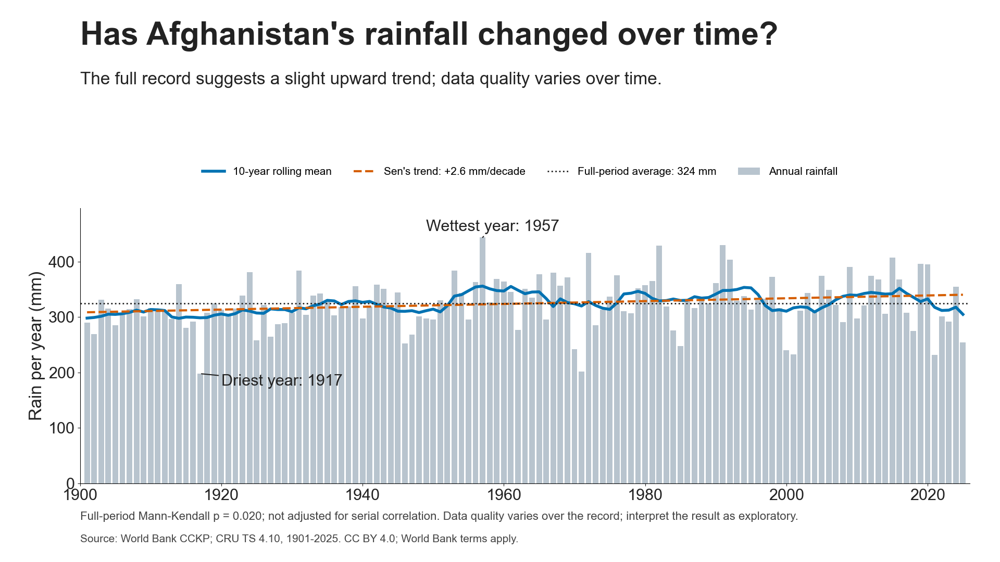

# Afghanistan rainfall trend, 1901-2025

This infographic summarizes the full available annual precipitation record for Afghanistan. It does not compare separate time periods.

## Main finding

Sen's slope is about **+2.55 mm per decade** (95% interval: +0.48 to +4.64). The conventional Mann-Kendall test gives p = 0.020. This suggests an upward trend over the full record, but the statistical result is exploratory: the test does not adjust for serial correlation, and data quality varies over time.

## How to read the chart

- Bars show annual country-average precipitation.
- The solid line is a centered 10-year rolling mean.
- The dashed line shows the Sen's slope across the full 1901-2025 record.
- The dotted horizontal line is the full-period average; labels mark the wettest and driest years.

## Limitations, licence and credit

- This is a gridded national average, not a station measurement for every location. Station coverage and data quality can vary over time, especially in the early record.
- The conventional Mann-Kendall p-value does not adjust for serial correlation. Do not treat this exploratory result as definitive climate attribution or a forecast.
- This repository applies CC BY 4.0 under the World Bank Dataset Terms, including their additional conditions, to the CCKP response and data-derived figures. Credit the World Bank and identify CRU TS v4.10 as the data source. Do not imply World Bank endorsement.
- CRU's own CRU TS 4.10 page states ODbL terms for the dataset and Database Contents License terms for individual contents. This repository's working determination applies to the CCKP-distributed response. See the [source record](../../data/sources/cru-ts-precipitation/README.md) for the terms links and attribution details.

## Related material

- [Full analysis and methods](../../analysis/afghanistan-rainfall-trend/README.md)
- [Dataset documentation](../../data/datasets/afghanistan-precipitation/README.md)
- [Source record](../../data/sources/cru-ts-precipitation/README.md)
