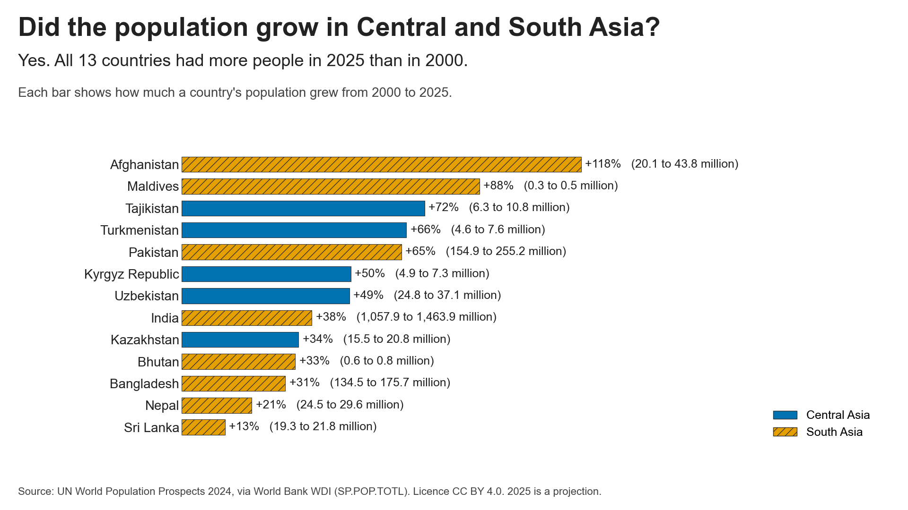

# Teacher notes: Did the population grow in Central and South Asia?

**Infographic:** [PNG](outputs/infographic_en.png) and [SVG](outputs/infographic_en.svg)
**Built from:** the analysis `population-growth-2000-2025` and the dataset `population-central-south-asia`, as named in `infographic.yaml`.

## Learning objective

Students can read a sorted bar chart, and can explain the difference between a percentage change and a change in the number of people.

## What the chart shows

Each bar is one of the 13 countries in the Central and South Asia group. The bars are sorted from the largest percentage rise at the top to the smallest at the bottom. Each bar is labelled with its percentage change, and with its population in 2000 and in 2025, in millions. Colour and hatching show the sub-region, Central Asia or South Asia.

The headline answers the question: every country had more people in 2025 than in 2000.

## Discussion questions

- Afghanistan's population rose by about 118 percent, and Sri Lanka's rose by about 13 percent. Compare the two bars. What does the percentage tell you that the number of people does not?
- Which is larger in people: Afghanistan's increase or Sri Lanka's? How can you tell from the labels?
- What would you need to know to decide whether a country's growth is fast or slow for a long period, rather than for a single year?

## Common misunderstandings

- **"The chart shows the size of each population."** It does not. Each bar shows the percentage change, not the total population.
- **"The 2025 numbers are counts."** They are projections from a model, because the UN estimates end in 2023.
- **"A bigger percentage means more people were added."** A small country can show a large percentage from a small change in numbers.

## Caveats

- The 2000 values are model-based estimates. The 2025 values are projections.
- Afghanistan has not had a nationwide census since 1979. The National Statistics and Information Authority (NSIA) reported 36.4 million people for 2025, while this chart uses 43.8 million from the UN-based estimate. The percentage rise for Afghanistan should be read as approximate.
- The chart does not explain why populations grew. It shows only how much they grew.

## Alt text

Horizontal bar chart of 13 countries, sorted by how much their population grew from 2000 to 2025. The title asks whether the population grew, and the headline answers yes: all 13 countries had more people in 2025 than in 2000. Afghanistan has the largest bar, at about 118 percent, with its population rising from 20.1 million to 43.8 million. Sri Lanka has the smallest bar, at about 13 percent, rising from 19.3 million to 21.8 million. Bars are coloured and hatched by sub-region, and the labels give the values for each country.

## Licence and credit

Content is CC BY 4.0. Credit the UN Population Division, World Population Prospects 2024 revision, and the World Bank, World Development Indicators (indicator SP.POP.TOTL).
