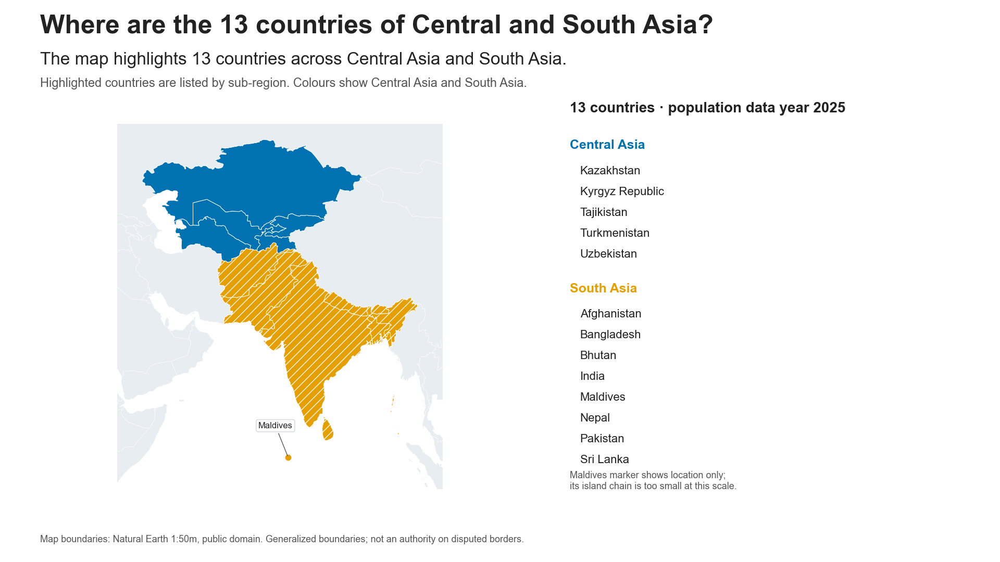

# Teacher notes: Where are the 13 countries of Central and South Asia?

**Infographic:** `outputs/infographic_en.png`  
**Built from:** the population dataset named in `infographic.yaml`, plus Natural Earth country-boundary geometry for the map shapes.

## Learning objective

Readers can locate the 13 countries in Central and South Asia and distinguish the two sub-regions on a map.

## What the map shows

The map highlights Afghanistan, Bangladesh, Bhutan, India, Kazakhstan, Kyrgyzstan, Maldives, Nepal, Pakistan, Sri Lanka, Tajikistan, Turkmenistan, and Uzbekistan. Blue and orange distinguish Central Asia and South Asia. A side panel lists each country by sub-region.

The map uses Natural Earth 1:50m boundaries. The Maldives is too small to show clearly at the map's scale, so a marker points to its location. The marker is not the boundary or shape of the islands.

## Discussion questions

- Which highlighted countries are in Central Asia, and which are in South Asia?
- Which highlighted countries share a border?
- Why might a map use a locator marker for a small island group?

## Common misunderstandings

- **"The colours show population size."** They do not. Colour shows sub-region only.
- **"The Maldives marker is the country's shape."** It marks the location; it does not represent the islands' boundary or size.
- **"These borders settle territorial disputes."** They do not. The map is a general reference.

## Caveats

- Natural Earth boundaries are generalized for mapping and show de facto boundaries. They are not an authority on disputed borders.
- The map does not show population totals or within-country differences.
- The Maldives location marker is illustrative, not a precise boundary.

## Alt text

A regional map of Central and South Asia highlights 13 countries in blue and orange by sub-region. Their names are listed in a side panel. Kazakhstan is at the north of the map; India, Sri Lanka, and a callout for the Maldives are toward the south. The Maldives marker shows location only, not the shape or boundary of the islands.

## Licence and credit

The infographic content is CC BY 4.0. Country-boundary geometry is Natural Earth, public domain. The country names and sub-regions come from the `population-central-south-asia` dataset.