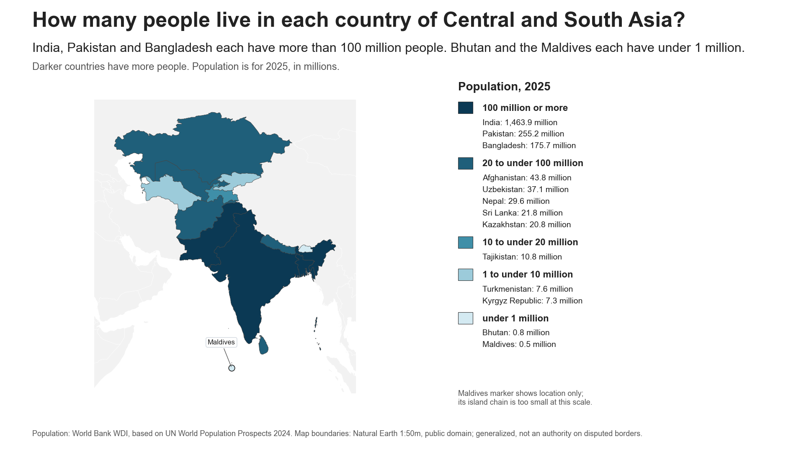

# Teacher notes: How many people live in each country of Central and South Asia?

**Infographic:** `outputs/infographic_en.png`  
**Built from:** the analysis `population-ranking-2025` and the dataset `population-central-south-asia`, plus Natural Earth country-boundary geometry for the map shapes.

## Learning objective

Readers can compare the populations of the 13 countries in Central and South Asia and explain why the map uses classes rather than a smooth colour scale.

## What the map shows

Each country is shaded by its total population in 2025, in five classes from darkest (100 million or more) to lightest (under 1 million). The side panel gives the class limits and each country's population in millions. Colour shows class only; the numbers are printed beside the map.

Population values are the World Bank's estimates, based on the UN World Population Prospects 2024.

## Why these colour classes

Populations range from about 0.5 million (Maldives) to about 1,464 million (India). On a smooth colour scale, 10 of the 13 countries would fall in the lightest 7% of the range and look the same. The classes use fixed limits (100, 20, 10 and 1 million) so that the differences between smaller countries stay visible.

## Discussion questions

- Which countries are in the darkest class, and what do they have in common?
- Why would a map of total population look different from a map of population per square kilometre?
- Why do the limits of the classes matter? What would the map look like with limits of 50, 25 and 5 million?

## Common misunderstandings

- **"The darkest country is the biggest country by area."** No. The shading shows people, not land area. India is large in both; Bangladesh has far more people than its small area suggests.
- **"Each shade is an equal step in population."** No. The classes are not equal in size. The top class covers all countries above 100 million; the bottom class covers everything under 1 million.
- **"The Maldives marker is the country's shape."** It marks the location only. The island chain is too small to show at this scale.

## Caveats

- Population is the total for the whole country in one year (2025). It does not show density, growth or age structure.
- Estimates for 2025 are projections. They carry uncertainty, which the source does not give for each country on this map.
- Natural Earth boundaries are generalized for mapping and show de facto boundaries. They are not an authority on disputed borders.
- The Maldives location marker is illustrative, not a precise boundary.

## Alt text

Map of 13 countries in Central and South Asia, shaded from dark to light by 2025 population. India, Pakistan and Bangladesh are darkest, with more than 100 million people each. Bhutan and the Maldives are lightest, with under 1 million each. A side panel lists each country's population. The Maldives is shown by a marker, not its island shape.

## Licence and credit

The infographic content is CC BY 4.0. Country-boundary geometry is Natural Earth, public domain. Population values come from the `population-central-south-asia` dataset (World Bank WDI, CC BY 4.0), and the 2025 ranking comes from the `population-ranking-2025` analysis.
